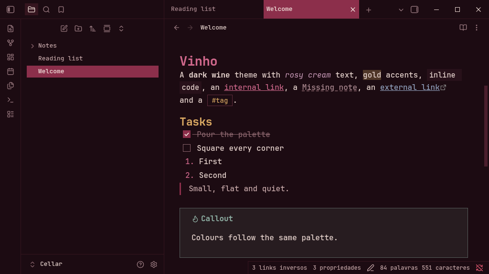

# Vinho

A dark wine theme for [Obsidian](https://obsidian.md): rosy cream text, gold and sage accents, square corners and no shadows. Includes a light mode.

## Features

- Dark and light modes built on the same palette
- Flat tabs, square controls and flush status bar, like a terminal
- Coloured headings, links, tags, callouts, tables, code and graph
- Built with CSS variables only where possible, no `!important`, no network calls

The theme uses [JetBrains Mono](https://www.jetbrains.com/lp/mono/) if it is installed, and your system monospace font otherwise. You can pick any other font in **Settings → Appearance**.

## Installation

**Settings → Appearance → Themes → Manage**, then search for *Vinho*.

Manual: copy `manifest.json` and `theme.css` to `<vault>/.obsidian/themes/Vinho/`.

## Palette

| | Dark | Light |
|---|---|---|
| Background | `#1c0b12` | `#fbf3ef` |
| Raised | `#28111a` | `#f3e5e0` |
| Wine | `#8c2f4b` | `#8c2f4b` |
| Text | `#e8d5cf` | `#35151f` |
| Accent | `#d0688c` | `#8c2f4b` |
| Gold | `#d9a862` | `#855b16` |
| Sage | `#a3ad7a` | `#58652a` |
| Blue | `#93a3c0` | `#435782` |

## License

[MIT](LICENSE)
